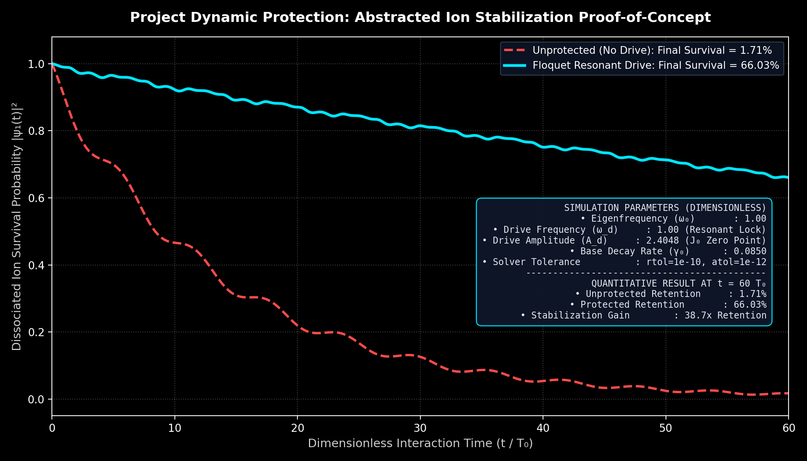

# Project Dynamic Protection — Open-Source Floquet Coherence Toy Model

An open-source, dimensionless computational physics prototype exploring how periodic electromagnetic modulation (Floquet driving) and spatial potential gradients can suppress decoherence and stabilize open quantum systems in noisy, non-equilibrium environments.

> **Scope & IP Notice:** This public repository provides general, dimensionless open-quantum-system numerical benchmarks and educational toy models (compatible with Python / JAX / QuTiP workflows). Specific industrial frequency recipes, chemical parameters, and hardware reactor geometries remain proprietary for Phase 2 commercialization.
## Benchmark Result (`t = 60 T₀`)

## Key Features (Phase 1 Prototype)
- **Dimensionless Lindblad Master Equation Solver:** Evaluates coherence lifetime ($\rho_{01}$) under thermal dephasing and relaxation noise.
- **Floquet Periodic Driving Comparison:** Compares unmodulated decay vs. resonant dynamic stabilization.
- **Reproducible Benchmarks:** Lightweight Python implementation designed to scale to GPU-accelerated JAX tensors.

## Links
- **Research Updates (X):** [@hamilt_onian] : https://x.com/hamilt_onian
- **Crowdfunding & Roadmap:** [Giveth Project Page] : https://giveth.io/project/dynamic-protection-quantum-co2-decomposition-poc
